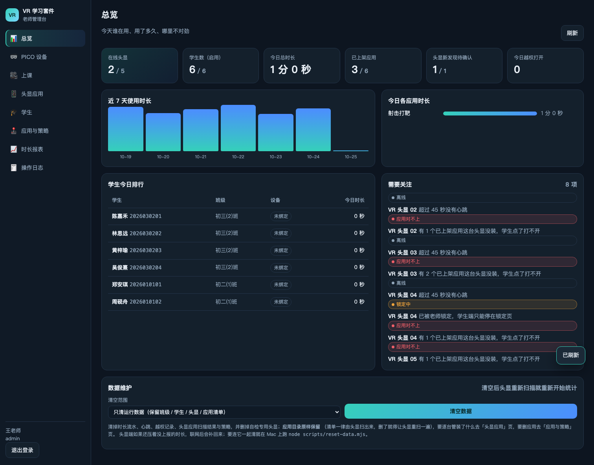
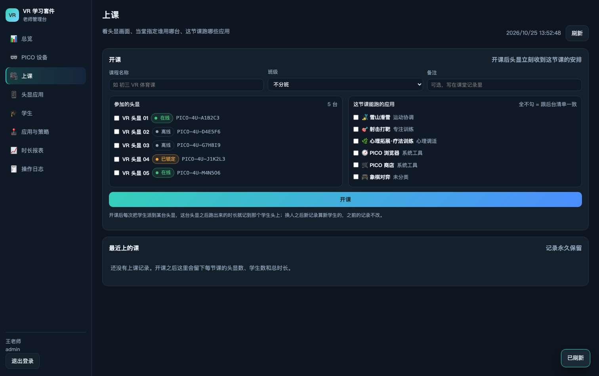
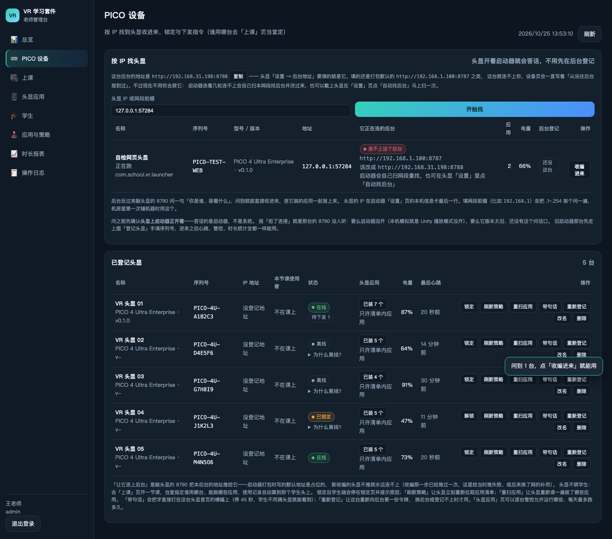
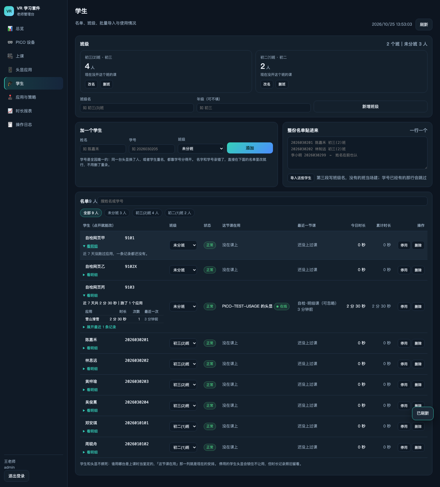
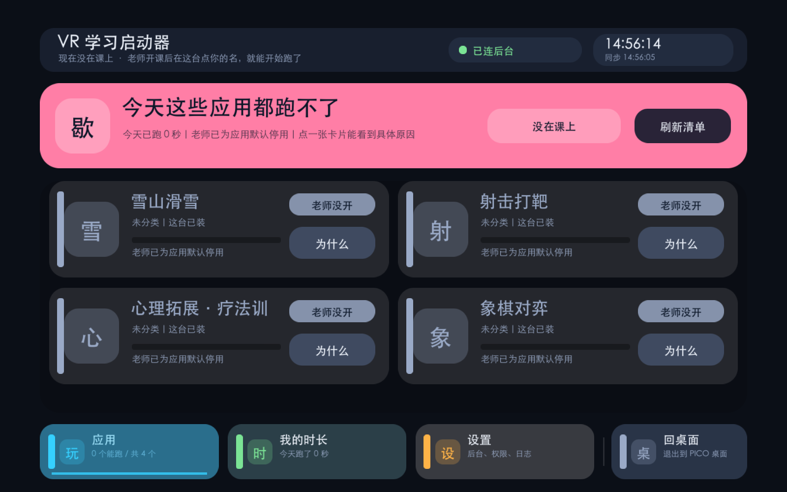
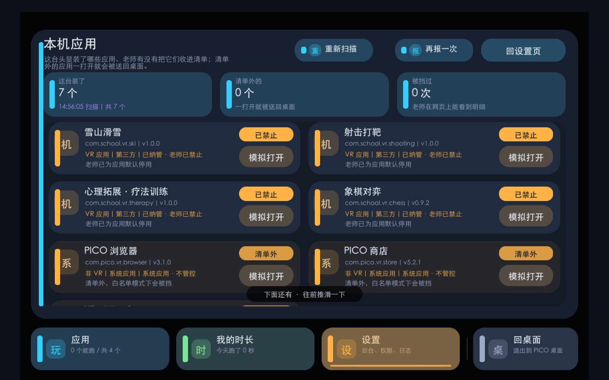

# VR 学习套件 · PICO 头显课堂管控

学校机房里的一套「头显 + 老师后台」：学生戴上 PICO 只跑得到老师放开的应用，时长自动记下来；
老师在网页里登记头显、管学生名单、开一节课当堂指定谁用哪台、实时看头显画面、出时长报表。

两块各自独立跑：

| 目录 | 是什么 | 跑在哪 |
| --- | --- | --- |
| `pico/` | 头显启动器（团结引擎工程，界面全中文） | PICO 4 头显（APK） |
| `server/` | 老师后台：HTTP 接口 + 管理网页（Node.js，零第三方依赖） | 老师的电脑 / 机房服务器 |

## 头显端

- 启动后自己向后台登记，之后每 10 秒一次心跳；老师在网页上改任何东西，头显下次心跳就重拉清单（认后台改动版本号，不用等定时轮询）
- 只允许跑管理清单里放开的软件：清单外的应用被拦回桌面，并给老师留一条越权记录
- 策略分「头显 / 学生 / 班级 / 全校」四层：能不能跑、每天跑几分钟、哪个时段能跑
- 上课中：横幅写清这节课叫什么、这台是谁在用，并把画面按后台要求的间隔推给老师
- 老师可远程下发指令：锁定 / 解锁 / 重扫应用 / 重新登记 / 带一句话（45 秒内打在首页横幅上）
- 连不上后台会自己扫本网段找后台，不用谁先把 IP 敲进设置页

## 老师后台

- 按 IP 找头显并登记，之后能远程让它重扫应用、推后台地址、锁定解锁
- 学生与班级：行内改姓名学号、整份名单粘贴导入、班级增删；**学生不和头显绑死**，谁用哪台是上课时当堂定的
- 上课：开一节课 → 当堂把学生点到某台头显上 → 定这节课跑哪些应用 → 看每台画面
- 头显应用：应用清单一律来自头显自己扫描上报，后台不手工编，逐台配能不能跑
- 时长报表按应用 / 学生 / 设备 / 日期统计，操作日志记下谁在什么时候改了什么
- 默认账号 `admin` / `pico123456`，上线前记得改

## 快速开始

后台（Node 22.5+，没有依赖要装）：

```bash
bash scripts/dev.sh      # 起在 http://127.0.0.1:8787，第一次跑自己建库并写种子数据
```

头显（要团结引擎 1.10.x / Unity 2022.3.62t16 —— 工程里的 XR 包是 `-t2`，标准 Unity 会卡在包解析）：

```bash
bash scripts/unity.sh apk      # 打 APK；装到已连上的头显用 adb install -r Build/Android/VR-Launcher.apk
```

头显和后台在同一网段就行：头显设置页里「自动找后台」会自己扫出来，老师这边也可以按 IP 反向登记。

## 自检

三条链路各有自检，不引第三方测试框架，跑在一次性临时库上，不动真数据：

```bash
bash scripts/test.sh api      # 后台接口全链路（登记 → 扫描 → 逐台管控 → 越权 → 时长 → 报表）
bash scripts/test.sh web      # 老师网页：真开一个 Chromium 把每页点一遍，顺手抓图到 Build/WebScreens/
bash scripts/test.sh unity    # 启动器无头自检：进播放模式真跑「读本机应用 → 上报 → 拦截 → 空清单」
```

当前：接口 215 条、网页 92 条、无头 27 条，全绿。
`node scripts/apk-check.mjs --strict` 能验一个 APK 到底是不是含最新功能的包（只看文件时间会骗人）。

## 界面

| 老师后台 · 总览 | 老师后台 · 上课（看头显画面） |
| --- | --- |
|  |  |

| 老师后台 · 按 IP 登记头显 | 老师后台 · 学生名单与明细 |
| --- | --- |
|  |  |

头显端（PC 模拟下抓的，界面全中文）：

| 主界面 | 本机应用页 |
| --- | --- |
|  |  |

## 更多

`docs/方案.md` 是把这套东西从需求一路做到现在的完整记录：每个决定为什么这么定、
踩过的坑的根因在哪一行、各条链路怎么验的。改这套代码之前值得先看它的目录。
